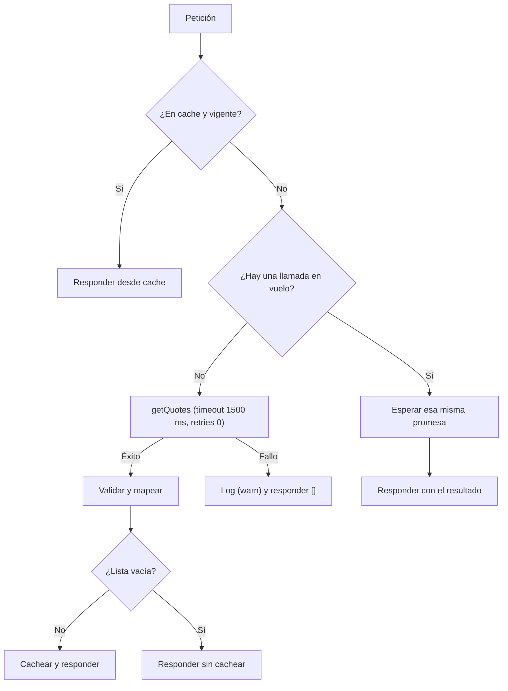

# Respuestas — VTEX IO Challenge

|                                 |                              |
| ------------------------------- | ---------------------------- |
| **Nombre**                      | Oscar Santiago Perez Espitia |
| **Tiempo aproximado invertido** | 6h aprox                     |
| **Entorno**                     | Local, sin cuenta VTEX       |
|                                 |                              |

## Store

### 1. Error de sintaxis en `store/blocks.jsonc`

Faltaba la coma entre `"showCarrierName": true` y `"blockClass": "pdp"`

```diff
-      "showCarrierName": true
+      "showCarrierName": true,
       "blockClass": "pdp"
```

El archivo es un JSON y JSONC y las "props" se separan entre si por comas.

### 2. Interface de `shipping-estimate-badge`

```jsonc
"shipping-estimate-badge": {
  "component": "ShippingEstimateBadge"
}
```

La interface conecta el nombre del bloque con el código que lo renderiza. Su propiedad `component` no se refiere a la carpeta `components/`, sino al nombre de un archivo en la **raíz de `react/`:** el builder `react` solo expone como componentes los archivos que están ahí. Por eso apunta a `ShippingEstimateBadge`, un archivo que exporta el componente real de `components/ShippingEstimateBadge.tsx`.

Sin esta interface, el bloque `shipping-estimate-badge#pdp` declarado en `blocks.jsonc` no tiene un componente asociado y la store no puede visualizarlo.

---

## Componente React

### 3. Tipado de `showCarrierName`

```diff
-  showCarrierName: boolean
+  showCarrierName?: boolean
...
-  showCarrierName,
+  showCarrierName = false,
```

Las props las define quien arma la store en `blocks.jsonc`, no el componente. Con el `?` la prop deja de ser obligatoria, y el `= false` evita que llegue como `undefined`. Se eligió `false` por ser lo más conservador: sin la prop el badge muestra solo días y precio, y quien quiera ver la transportadora la activa explícitamente. El bloque ya no falla si la store no la configura.

### 4. Acceso seguro a `product.productId`

```ts
const productId = productContext?.product?.productId;
```

Con el acceso original (`productContext.product.productId`), la página podía romperse si `product` aún no estaba disponible, por ejemplo fuera de un `product-context` o mientras el producto carga. El "optional chaining operator" (`?.`) lo evita: en esos casos `productId` queda en `undefined`.

Pero eso solo no basta: la query declara `$productId: ID!`, así que enviarla con `undefined` produciría un error de validación de GraphQL. Por eso se propone complementar con:

- `skip: !productId` en `useQuery`, para no hacer la petición hasta tener un id válido.
- Devolver `null` en el render, para que el componente no muestre nada mientras no haya un producto.

Cuando el producto termina de cargar, `productId` pasa a tener valor y la query se ejecuta sola.

### 5. Resolución de `defaultPostalCode`

```ts
const postalCode =
  orderForm?.shippingData?.address?.postalCode || FALLBACK_POSTAL_CODE;
```

El código postal se toma de la dirección del comprador en el `orderForm`, usando `useOrderForm()` de `vtex.order-manager/OrderForm`, dependencia que ya estaba declarada en el `manifest.json`. Solo cuando esa dirección no existe se recurre a `'110111'`, definido como la constante `FALLBACK_POSTAL_CODE`, de modo que el valor por defecto es el último recurso y no el punto de partida.

> **Ejemplo:** un usuario puede no tener todavía una dirección registrada. En ese caso el estimado es **referencial**, porque se calcula para el código postal por defecto y no para la zona registrada del usuario. Se prefiere mostrar ese estimado a no mostrar nada, ya que `postalCode` es obligatorio (`String!`) en el schema.

### 6. Manejo de `loading` y `error`

| Estado de la query          | Render                         | Motivo                                                                      |
| --------------------------- | ------------------------------ | --------------------------------------------------------------------------- |
| Sin `productId` o `loading` | `null`                         | Es un complemento, no el contenido principal: no justifica un spinner       |
| `error`                     | mensaje con el handle `error`  | Permite estilizarlo u ocultarlo por CSS                                     |
| `data` vacío o `null`       | `null`                         | Sin estimado no hay nada útil que mostrar                                   |
| Datos válidos               | badge con la opción más rápida | Es el dato útil para el comprador: el menor tiempo de entrega, con su costo |

`data` solo se lee después de estas comprobaciones, así que ya no puede fallar por `undefined`

### 7. Optimización de renders

**Problemas detectados:**

1. `data.estimateShipping.sort(...)` **muta** el arreglo, que es el resultado cacheado de React Apollo: un efecto colateral que puede corromper el cache y provocar renders extra por la mutacion.
2. El cálculo de `fastest` se rehacía en cada render.
3. El componente reaccionaba a cualquier cambio del `product-context` (por ejemplo al elegir otro SKU), aunque el resultado no cambiara.

**Cambios realizados:**

- Las variables de la query se construyen solo con valores **primitivos** (`productId` y `postalCode`, ambos son strings) extraídos del contexto del producto, en lugar de depender de los objetos completos. Así React Apollo solo vuelve a consultar cuando cambia alguno de esos dos valores, y no cada vez que el contexto se actualiza.
- `fastest` se calcula con `useMemo(..., [data])`, así que no se recalcula en renders donde `data` no cambió.
- La opción más rápida se obtiene con `reduce` en vez de `sort`: no muta el array `data`, no copia el arreglo y lo recorre una sola vez. Ya que solo se necesita el mínimo, no la lista ordenada.
- El componente se exporta con `React.memo`, para que no se vuelva a renderizar si el padre se actualiza sin que cambien sus props. Su efecto es limitado: el producto y el `orderForm` llegan por contexto/hooks, y `React.memo` no evita los renders que estos provocan.
- **Nota:** `ShippingEstimateBadge.schema` se asigna al componente interno, y `React.memo` devuelve un wrapper que no hereda esa propiedad. Por eso el `schema` (usado por el Site Editor) no llega al export. No afecta a la PDP, donde las props se configuran en `blocks.jsonc`. Si se necesitara en el Site Editor, bastaría con asignarlo también al componente memoizado.

## GraphQL y Node

### 8. Argumentos en el schema y firma del resolver

```graphql
type Query {
  estimateShipping(productId: ID!, postalCode: String!): [ShippingEstimate]
}
```

El front ya enviaba `productId` y `postalCode` (`graphql/estimateShipping.graphql`), pero el schema no los declaraba y el resolver usaba valores fijos (`'1'`, `'110111'`). Ahora los tipos coinciden con las variables de la query y son obligatorios, porque sin ellos no se puede cotizar. El resolver recibe `args: { productId: string; postalCode: string }` como segundo parámetro, y al quitar los valores fijos cada producto y código postal obtiene su propia cotización, lo que habilita el cache de #9.

### 9. Resolver: timeout, errores, fallback y caching



#### Timeout

`service.json` limita el service a **2 s**, pero el client usaba por defecto **10 s con 2 reintentos**, así que el service habría muerto antes de poder responder un fallback. La llamada ahora usa `timeout: 1500 ms` y `retries: 0` (`getQuotes` acepta ambas opciones): deja ~500 ms para responder dentro del límite y es preferible fallar rápido y que la siguiente petición reintente.

#### Errores y fallback

- El error se captura con `try/catch` y se registra con `ctx.vtex.logger.warn`, sin propagarlo crudo al front.
- Se valida que la respuesta sea un arreglo y se descartan las cotizaciones mal formadas.
- Ante cualquier fallo, o timeout o respuesta vacía se devuelve un array vacio `[]` y el front oculta el badge. Se prefiere a un error GraphQL porque el estimado complementa la PDP, pero no es su contenido principal: una falla de este servicio no debería degradarla, y el front ya sabe tratar el array vacio `[]`.

#### Estrategia de caching

| Aspecto                     | Decisión                                               | Justificación                                                            |
| --------------------------- | ------------------------------------------------------ | ------------------------------------------------------------------------ |
| **Qué se cachea**           | La lista ya mapeada, solo si es exitosa y **no vacía** | Los fallos y vacíos no se guardan: la siguiente petición reintenta       |
| **Clave**                   | `productId:postalCode`                                 | Son las únicas entradas de las que depende la cotización                 |
| **TTL**                     | 5 minutos                                              | Las tarifas cambian poco y un dato levemente desactualizado es aceptable |
| **Tamaño**                  | Máx. 500 entradas; se descarta la más antigua          | Acota la memoria (service de 256 MB)                                     |
| **Peticiones concurrentes** | Comparten una sola llamada en vuelo                    | Evita ráfagas de llamadas externas cuando varias PDP piden lo mismo      |

Se guarda en memoria del proceso, sin dependencias nuevas, por ser la opción más simple. Su limitación es que el cache es **por réplica** (`minReplicas: 2`, `maxReplicas: 4`) y se pierde al reiniciar, lo cual es aceptable para un estimado. Si hiciera falta, se compartiría entre réplicas con VBase y se serviría el dato expirado mientras se revalida en segundo plano; no lo implementé para no sobredimensionar la solución.

### 10. Health check (`health.ts`)

| Resultado del `ping` | Status | Body                                         |
| -------------------- | :----: | -------------------------------------------- |
| El servicio responde | `200`  | `{ "status": "ok" }`                         |
| Falla o no responde  | `503`  | `{ "status": "down", "error": "<mensaje>" }` |

**Qué estaba mal antes:** devolvía `201` con body `'ok'` (texto, no JSON) en éxito y `200` en fallo, y serializaba el objeto `error` completoo.

**Ahora:** códigos correctos para que un balanceador o monitor distinga la salud real, body JSON consistente en ambos casos (solo `error.message`), `Content-Type: application/json` y `Cache-Control: no-store` para que el resultado nunca se cachee.

---

## Notas adicionales

### Cambios no pedidos explícitamente

- **`react/typings/global.d.ts`:** se unificaron en un solo archivo las declaraciones de tipos: `StorefrontFunctionComponent`, los imports `*.graphql` y versiones mínimas de `vtex.product-context`, `vtex.order-manager/OrderForm` y `vtex.css-handles` (los tipos reales de VTEX no existen fuera de la plataforma). El archivo no tiene `import` de nivel superior a propósito: así el editor registra bien las declaraciones con comodín. No afecta al build en VTEX.
- **`node/clients/index.ts`:** `getQuotes` acepta `{ timeout, retries }` opcionales; es necesario para el punto #9.
- **`.gitignore`:** `node_modules/` y `package-lock.json`.

### Verificación realizada

- `tsc --noEmit` en `node/` y `react/` sin errores en el código propio (los errores restantes vienen de tipos de terceros que no compilan con TypeScript 3.9.7).
- Parseo del JSONC de `store/`.
- El resolver se probó con un script desechable y un client simulado: mapeo y filtrado de cotizaciones inválidas, cache hit en la segunda llamada, fallo → `[]` con warning y lista vacía → `[]`.

### Pendiente o con más tiempo

- **Tests** del resolver, del health y del componente, con jest y ts-jest compatibles con TS 3.9. El cache de módulo necesitaría una función para reiniciarse entre tests.
- **Cache compartido y _stale-while-revalidate_** (ver punto #9).
- **Prueba de integración en un workspace real** con `vtex link`, para validar el `orderForm` y el comportamiento en la PDP.
- **Métricas y alertas** sobre la tasa de fallbacks del resolver, para detectar degradación del servicio externo.
- **Reorganizar el componente si crece.** Hoy `ShippingEstimateBadge.tsx` (~100 líneas, una sola responsabilidad) mezcla datos, lógica y vista, y no vale la pena separarlo todavía. Si crece, separaría así (el entry point `react/ShippingEstimateBadge.tsx` no cambia):

  ```
  react/components/ShippingEstimateBadge/
  ├── index.tsx               # compone el hook y la vista
  ├── useShippingEstimate.ts  # useProduct + useOrderForm + useQuery + cálculo de `fastest`;
  │                           # devuelve { fastest, loading, error }
  └── utils.ts                # formatPrice y tipos
  ```
